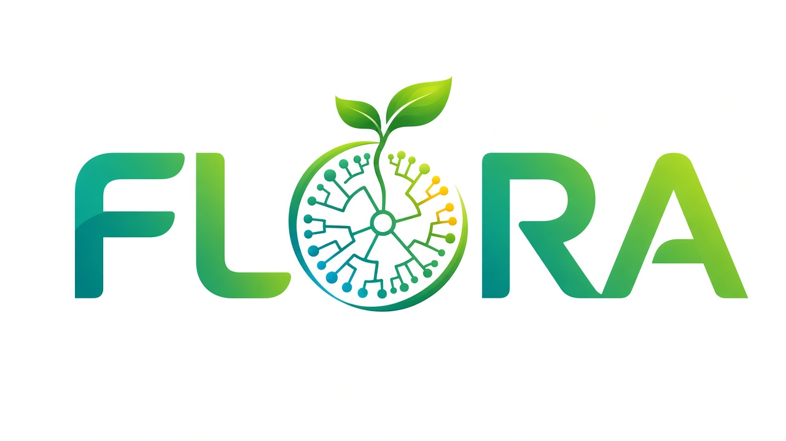
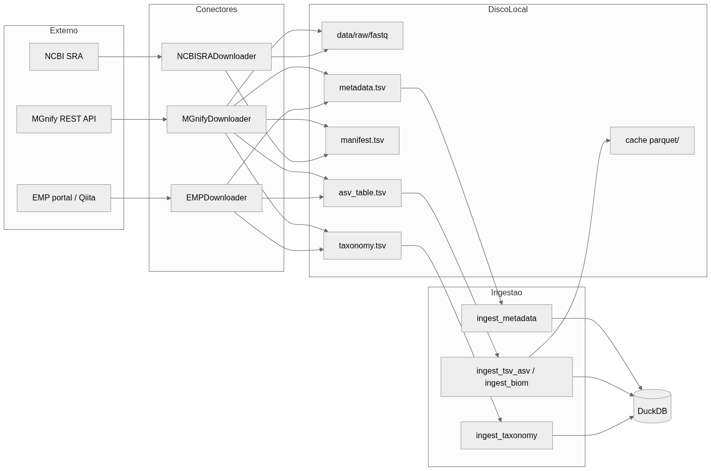

<p align="center">
  
</p>

<p align="center">
  
</p>

<h3 align="center">Feature Learning and Omics Research Analytics</h3>

<p align="center">
  🇺🇸 English · <a href="README.pt-BR.md">🇧🇷 Português</a>
</p>

<p align="center">
  Python framework for 16S rRNA microbiome analysis: public data ingestion, DuckDB analytics,
  feature engineering, machine learning and reporting, with a web interface.
</p>

<p align="center">
  
  
  
  
  
  
  
  
  
  
</p>

---

## Overview

<p align="center">
  
</p>

Flow: **public sources → connectors → raw files → ingestion → DuckDB/Parquet → features → ML → visualization and report**.

- **DuckDB** is the central query engine between ingestion and ML.
- **Polars** handles high-performance tabular transformations.
- **Parquet** is the intermediate format; no temporary state leaks between stages.
- Each **project** has its own DuckDB, raw files and manifest.

Details: [Architecture](docs/architecture.md) · [ADRs](docs/adr/) · [Capability matrix](docs/architecture/capability-matrix.md)

---

## Installation

```bash
pip install flora-bio                      # usage
git clone https://github.com/flora-bio/flora && cd flora
pip install -e ".[dev]"                    # development
conda env create -f environment.yml        # conda alternative
conda activate flora
```

Requires Python 3.11+. Step-by-step guide and optional dependencies: [Installation](docs/installation.md).

---

## Commands

| Command | What it does |
|---|---|
| `flora ui` | Starts the web interface |
| `flora download mgnify` | Downloads studies from MGnify |
| `flora download sra` | Downloads runs from NCBI SRA (requires `sra-tools`) |
| `flora download emp` | Downloads the Earth Microbiome Project (Release 1) |
| `flora download synthetic` | Generates synthetic data, no internet needed |
| `flora ingest [dir]` | Loads `metadata.tsv` / `manifest.tsv` into DuckDB |
| `flora run config.yaml` | Runs the pipeline from a config file |

See each command's options with `flora <command> --help`.

### Getting started in 3 steps

```bash
flora download synthetic        # 1. example data
flora ingest data/raw           # 2. ingest into DuckDB
flora ui                        # 3. opens the UI at http://127.0.0.1:8765
```

Useful UI options: `--host`, `--port`, `--workdir`, `--config`, `--no-browser`, `--log-level`.

Full guides: [Quick Start](docs/quickstart.md) · [User guide](docs/user_guide.md)

---

## Web interface

**Angular** SPA (`src/flora/front/`), served by `flora ui`. If the build is missing, the command shows a page explaining
how to generate it.

```bash
cd src/flora/front && npm install && npm run build
```

Documentation: [Interface](docs/ui.md) · [Projects and data sources](docs/projects.md) · [Graph guide](docs/graph_guide.md) · [Development](docs/development.md)

---

## Tests

```bash
pytest tests/ -v --cov=flora
```

Tests use in-memory DuckDB, with no external files or services.

---

## Documentation

Detailed documentation lives in `docs/` (browse it with `mkdocs serve`):

| Topic | Document |
|---|---|
| Architecture and decisions | [architecture.md](docs/architecture.md), [adr/](docs/adr/) |
| Installation and troubleshooting | [installation.md](docs/installation.md), [troubleshooting.md](docs/troubleshooting.md) |
| Usage | [quickstart.md](docs/quickstart.md), [user_guide.md](docs/user_guide.md) |
| Projects and source sync | [projects.md](docs/projects.md) |
| Public datasets | [datasets.md](docs/datasets.md) |
| Methods (normalization, diversity, ML) | [methods.md](docs/methods.md) |
| Experimental evaluation and reports | [experimental_evaluation.md](docs/experimental_evaluation.md), [emp_report.md](docs/emp_report.md), [report.md](docs/report.md) |
| Article | [article.md](docs/article.md) |
| Contributing | [contributing.md](docs/contributing.md), [development.md](docs/development.md) |

---

## License

MIT. See [LICENSE](LICENSE).
