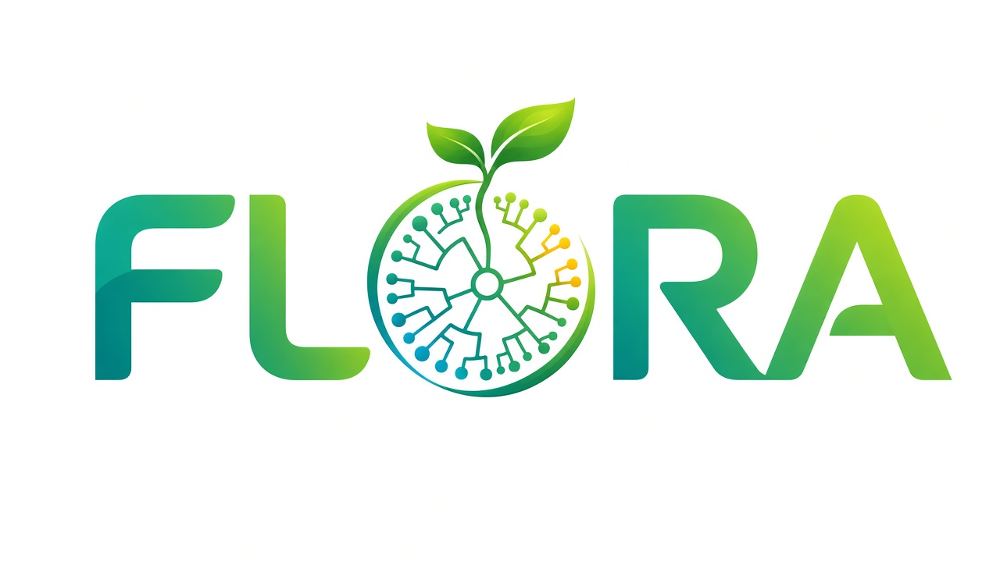
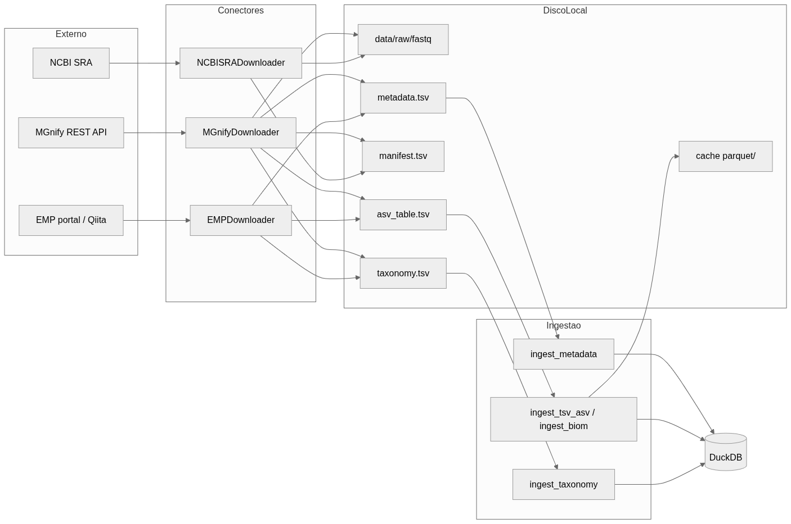

<p align="center">
  
</p>

<p align="center">
  
</p>

<h3 align="center">Feature Learning and Omics Research Analytics</h3>

<p align="center">
  🇧🇷 Português · <a href="README.md">🇺🇸 English</a>
</p>

<p align="center">
  Framework Python para análise de microbioma 16S rRNA: ingestão de dados públicos, analytics em DuckDB,
  engenharia de features, machine learning e relatórios, com interface web.
</p>

<p align="center">
  
  
  
  
  
  
  
  
  
  
</p>

---

## Visão geral

<p align="center">
  
</p>

Fluxo: **fontes públicas → conectores → arquivos brutos → ingestão → DuckDB/Parquet → features → ML → visualização e relatório**.

- **DuckDB** é o motor central de consultas entre a ingestão e o ML.
- **Polars** cuida das transformações tabulares de alto desempenho.
- **Parquet** é o formato intermediário; nenhum estado temporário vaza entre etapas.
- Cada **projeto** tem seu próprio DuckDB, seus arquivos brutos e seu manifesto.

Detalhes: [Arquitetura](docs/architecture.md) · [ADRs](docs/adr/) · [Matriz de capacidades](docs/architecture/capability-matrix.md)

---

## Instalação

```bash
pip install flora-bio                      # uso
git clone https://github.com/flora-bio/flora && cd flora
pip install -e ".[dev]"                    # desenvolvimento
conda env create -f environment.yml        # alternativa com conda
conda activate flora
```

Requer Python 3.11+. Passo a passo e dependências opcionais: [Instalação](docs/installation.md).

---

## Comandos

| Comando | O que faz |
|---|---|
| `flora ui` | Inicia a interface web |
| `flora download mgnify` | Baixa estudos do MGnify |
| `flora download sra` | Baixa runs do NCBI SRA (requer `sra-tools`) |
| `flora download emp` | Baixa o Earth Microbiome Project (Release 1) |
| `flora download synthetic` | Gera dados sintéticos, sem internet |
| `flora ingest [pasta]` | Carrega `metadata.tsv` / `manifest.tsv` no DuckDB |
| `flora run config.yaml` | Executa o pipeline a partir de um arquivo de configuração |

Veja as opções de cada um com `flora <comando> --help`.

### Começando em 3 passos

```bash
flora download synthetic        # 1. dados de exemplo
flora ingest data/raw           # 2. ingestão no DuckDB
flora ui                        # 3. abre a interface em http://127.0.0.1:8765
```

Opções úteis da interface: `--host`, `--port`, `--workdir`, `--config`, `--no-browser`, `--log-level`.

Guia completo: [Quick Start](docs/quickstart.md) · [Guia do usuário](docs/user_guide.md)

---

## Interface web

SPA em **Angular** (`src/flora/front/`), servida por `flora ui`. Se o build não existir, o comando mostra uma página
explicando como gerá-lo.

```bash
cd src/flora/front && npm install && npm run build
```

Documentação: [Interface](docs/ui.md) · [Projetos e fontes de dados](docs/projects.md) · [Guia de gráficos](docs/graph_guide.md) · [Desenvolvimento](docs/development.md)

---

## Testes

```bash
pytest tests/ -v --cov=flora
```

Os testes usam DuckDB em memória, sem arquivos ou serviços externos.

---

## Documentação

Documentação detalhada, em `docs/` (publicável com `mkdocs serve`):

| Tema | Documento |
|---|---|
| Arquitetura e decisões | [architecture.md](docs/architecture.md), [adr/](docs/adr/) |
| Instalação e solução de problemas | [installation.md](docs/installation.md), [troubleshooting.md](docs/troubleshooting.md) |
| Uso | [quickstart.md](docs/quickstart.md), [user_guide.md](docs/user_guide.md) |
| Projetos e sincronização de fontes | [projects.md](docs/projects.md) |
| Análises e motores externos (QIIME 2, DADA2…) | [analysis.md](docs/analysis.md) |
| Datasets públicos | [datasets.md](docs/datasets.md) |
| Métodos (normalização, diversidade, ML) | [methods.md](docs/methods.md) |
| Avaliação experimental e relatórios | [experimental_evaluation.md](docs/experimental_evaluation.md), [emp_report.md](docs/emp_report.md), [report.md](docs/report.md) |
| Artigo | [article.md](docs/article.md) |
| Contribuição | [contributing.md](docs/contributing.md), [development.md](docs/development.md) |

---

## Licença

MIT. Veja [LICENSE](LICENSE).
