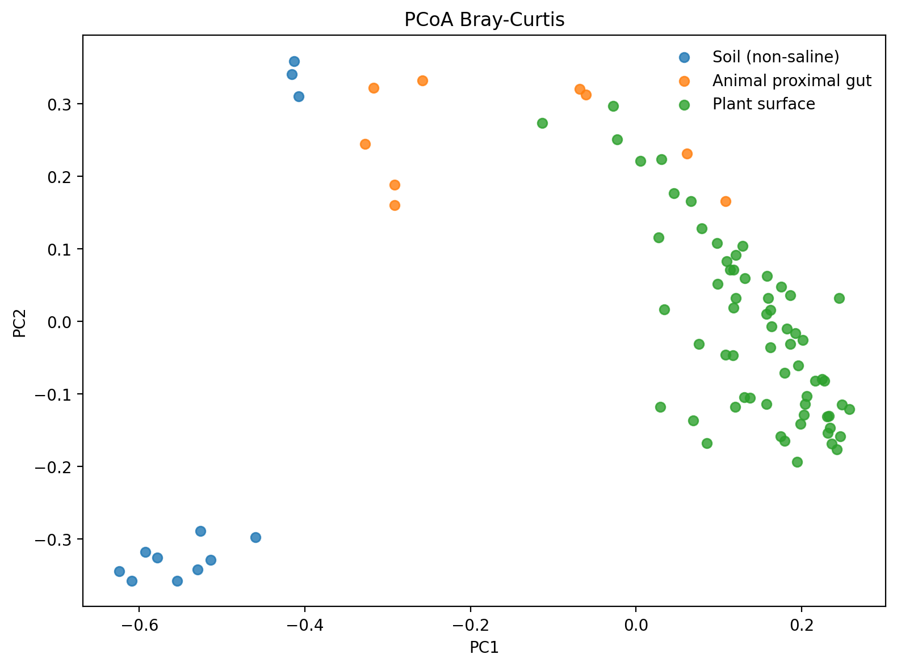
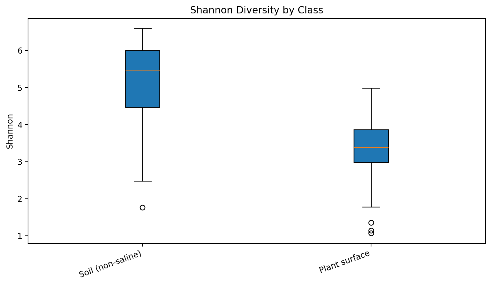
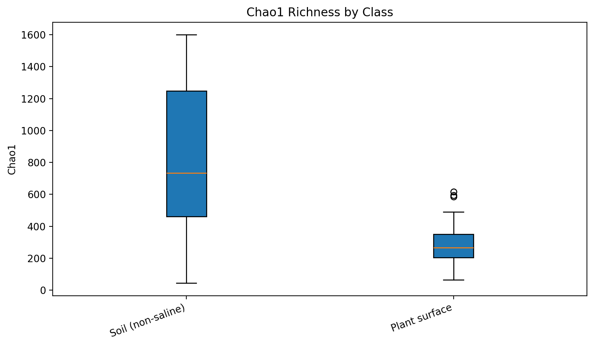
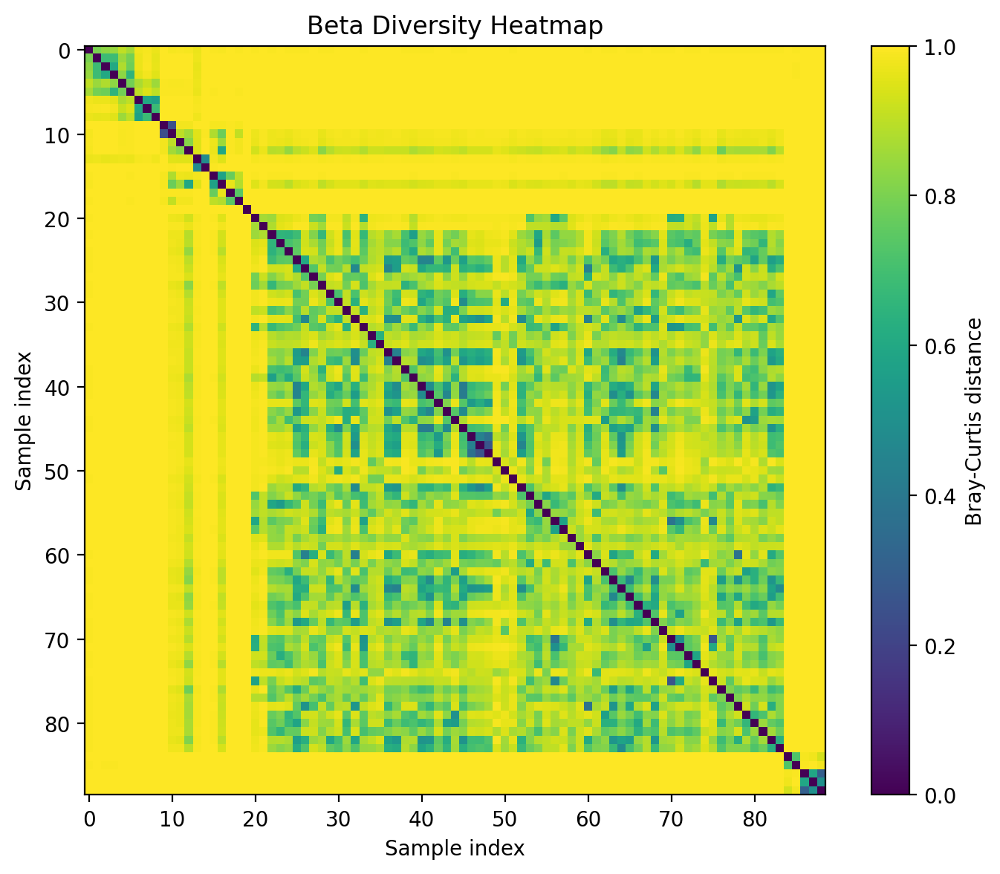
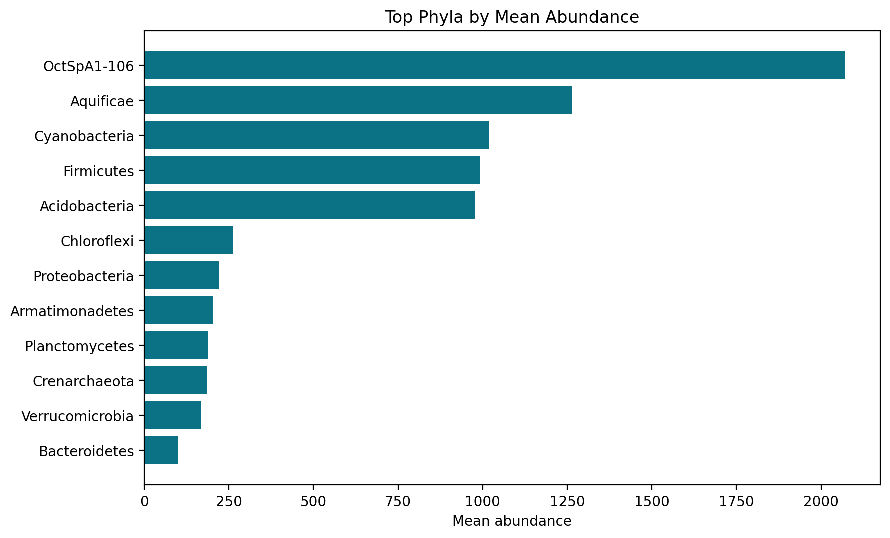
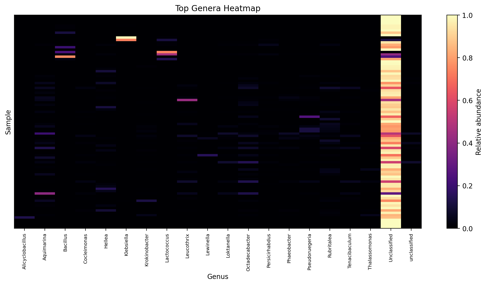
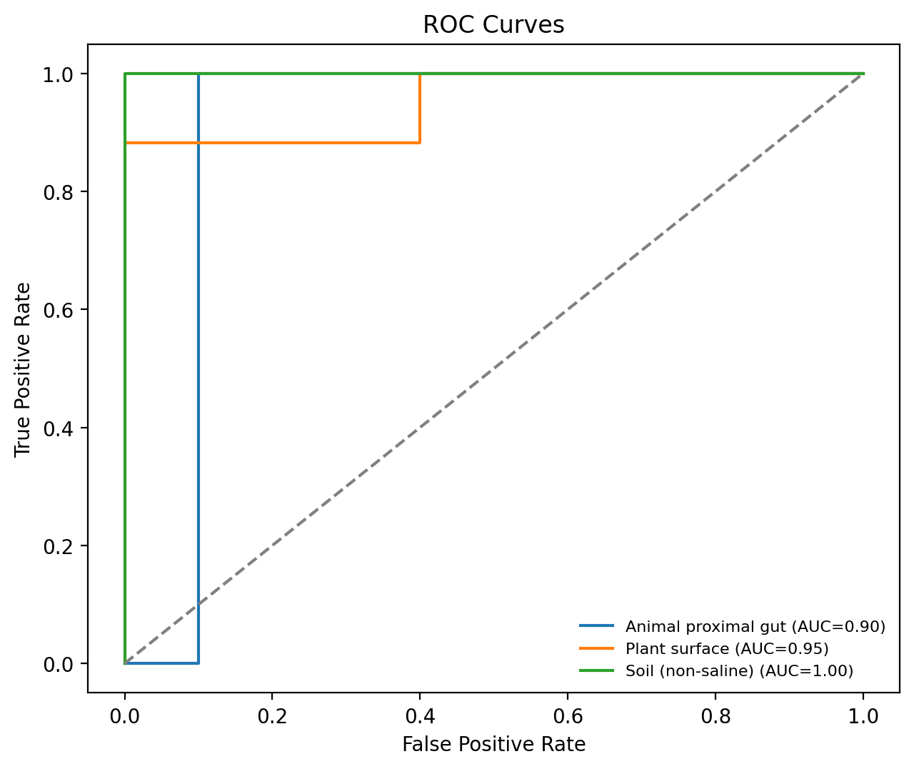
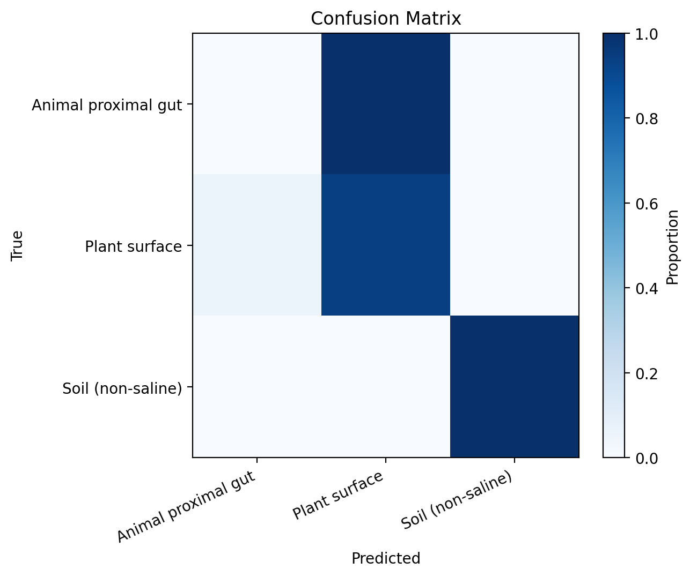
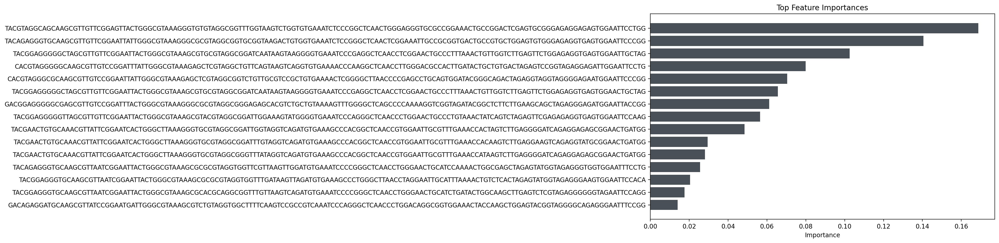
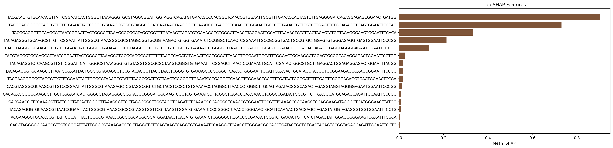

# EMP Analysis Report

Relatorio gerado automaticamente pela pipeline FLORA com os dados locais em `data/raw/emp`.

## Resumo Executivo

- Amostras totais ingeridas: **89**
- Amostras usadas no modelo: **85**
- Observacoes ASV carregadas: **28,857**
- Taxonomias carregadas: **197,711**
- Features apos filtro de prevalencia: **1,183**
- Acuracia no teste: **0.8636**
- F1-macro no teste: **0.6381**
- ROC-AUC: **0.9510**
- Leitura media por amostra: **16752.2**
- Top feature por SHAP: **TACGAACTGTGCAAACGTTATTCGGAATCACTGGGCTTAAAGGGTGCGTAGGCGGATTGGTAGGTCAGATGTGAAAGCCCACGGCTCAACCGTGGAATTGCGTTTGAAACCACTAGTCTTGAGGGGATCAGAGGAGAGCGGAACTGATGG** (0.9054)

Relatorio interativo completo: [`results/emp_report.html`](../results/emp_report.html)

## Distribuicao de Classes

| Classe | Amostras |
| --- | --- |
| Plant surface | 64 |
| Soil (non-saline) | 12 |
| Animal proximal gut | 9 |

## Diversidade

- Shannon medio: **3.5223**
- Shannon mediano: **3.3979**
- Chao1 medio: **354.84**
- Simpson medio: **0.8902**

## Top Filos

| Phylum | Abundancia media |
| --- | --- |
| OctSpA1-106 | 2070.6667 |
| Aquificae | 1265.2857 |
| Cyanobacteria | 1018.1475 |
| Firmicutes | 991.2819 |
| Acidobacteria | 978.3097 |
| Chloroflexi | 262.6611 |
| Proteobacteria | 221.0387 |
| Armatimonadetes | 203.7771 |
| Planctomycetes | 188.6234 |
| Crenarchaeota | 184.2459 |
| Verrucomicrobia | 168.0973 |
| Bacteroidetes | 99.6357 |
| Chlamydiae | 84.5000 |
| [Thermi] | 82.2383 |
| Actinobacteria | 58.0925 |

## Top Features por SHAP

| Feature | Mean |SHAP| |
| --- | --- |
| TACGAACTGTGCAAACGTTATTCGGAATCACTGGGCTTAAAGGGTGCGTAGGCGGATTGGTAGGTCAGATGTGAAAGCCCACGGCTCAACCGTGGAATTGCGTTTGAAACCACTAGTCTTGAGGGGATCAGAGGAGAGCGGAACTGATGG | 0.9054 |
| TACGGAGGGGGCTAGCGTTGTTCGGAATTACTGGGCGTAAAGCGTGCGTAGGCGGATCAATAAGTAAGGGGTGAAATCCCGAGGCTCAACCTCGGAACTGCCCTTTAAACTGTTGGTCTTGAGTTCTGGAGAGGTGAGTGGAATTGCTAG | 0.7308 |
| TACGGAGGGTGCAAGCGTTAATCGGAATTACTGGGCGTAAAGCGCGCGTAGGTGGTTTGATAAGTTAGATGTGAAAGCCCTGGGCTTAACCTAGGAATTGCATTTAAAACTGTCTCACTAGAGTATGGTAGAGGGAAGTGGAATTCCACA | 0.3324 |
| TACAGAGGGTGCAAGCGTTGTTCGGAATTATTGGGCGTAAAGGGCGCGTAGGCGGTGCGGTAAGACTGTGGTGAAATCTCCGGGCTCAACTCGGAAATTGCCGCGGTGACTGCCGTGCTGGAGTGTGGGAGAGGTGAGTGGAATTCCCGG | 0.2131 |
| CACGTAGGGCGCAAGCGTTGTCCGGAATTATTGGGCGTAAAGAGCTCGTAGGCGGTCTGTTGCGTCCGCTGTGAAAACTCGGGGCTTAACCCCGAGCCTGCAGTGGATACGGGCAGACTAGAGGTAGGTAGGGGAGAATGGAATTCCCGG | 0.1337 |
| TACGTAGGGTGCGAGCGTTAATCGGAATTACTGGGCGTAAAGCGTGCGCAGGCGGTTTTGTAAGCCAGATGTGAAATCCCCGGGCTTAACCTGGGAATGGCATTTGGGACTGCAAGGCTGGAGTGCGGCAGAGGAGACTGGAATTCCTGG | 0.0251 |
| TACAGAGGTCTCAAGCGTTGTTCGGATTCATTGGGCGTAAAGGGTGTGTAGGTGGCGCGCTAAGTCGGGTGTGAAATTTCGGAGCTTAACTCCGAAACTGCATTCGATACTGGCGTGCTTGAGGACTGGAGAGGAGACTGGAATTTACGG | 0.0192 |
| TACAGAGGGTGCAAGCGTTAATCGGAATTACTGGGCGTAAAGCGTGCGTAGACGGTTACGTAAGTCGGGTGTGAAAGCCCCGGGCTCAACCTGGGAATTGCATTCGAGACTGCATAGCTAGGGTGCGGAAGAGGGAAGCGGAATTTCCGG | 0.0185 |
| TACGAAGGGGGCTAGCGTTGTTCGGAATTACTGGGCGTAAAGCGTATGTAGGCGGATCGTTAAGTCGGGGGTGAAATCCCGAGGCTCAACCTCGGAACTGCCTTCGATACTGGCGATCTTCGAGTCCGGGAGAGGTGAGTGGAACTCCGA | 0.0168 |
| CACGTAGGGCGCAAGCGTTGTCCGGAATTATTGGGCGTAAAGAGCTCGTAGGCGGTCTGCTACGTCCGCTGTGAAAACCTAGGGCTTAACCCTGGGCTTGCAGTAGATACGGGCAGACTAGAGGTAGGTAGGGGAGAATGGAATTCCCGG | 0.0114 |
| GACAGAGGGGGCAAGCGTTGCTCGGAATCACTGGGCGTAAAGGGCGCGTAGGCGGGATGGCAAGTCGGTCGTGAAATCCTTCGGCTCAACCGAAGAACGTCGGCCGATACTGCCGTTCTTGAGGGATGCAGAGGAGATTGGAATTCCCGG | 0.0088 |
| GACGAACCGTCCAAACGTTATTCGGTATCACTGGGCTTAAAGCGTTCGTAGGCGGCTTGGTAGGTGAGATGTGAAAGCCCACGGCTCAACCGTGGAATTGCGTTTCAAACCCCCAAGCTCGAGGAAGATAGGGGTGATGGGAACTTATGG | 0.0070 |
| TACAGAGGGTGCAAGCGTTAATCGGAATTACTGGGCGTAAAGCGCGCGTAGGTGGTTCGTTAAGTTGGATGTGAAATCCCCGGGCTCAACCTGGGAACTGCATTCAAAACTGACGAGCTAGAGTATGGTAGAGGGTGGTGGAATTTCCTG | 0.0067 |
| TACGAAGGGTGCAAGCGTTATTCGGATTTACTGGGCGTAAAGCGCGCGCAGGCGGATGGATAAGTCAGATGTGAAATCTCGGGGCTCAACCCCGAAACTGCGTCTGAAACTGTTCATCTAGAGTATTGGAGGGGGAAGTGGAATTTCGCA | 0.0053 |
| CACGTAGGGGGCAAGCGTTGTCCGGATTTATTGGGCGTAAAGAGCTCGTAGGCTGTTCAGTAAGTCAGGTGTGAAAATCCAAGGCTCAACCTTGGGACGCCACCTGATACTGCTGTGACTAGAGTCCGGTAGAGGAGATTGGAATTCCTG | 0.0053 |
| CACGAAGGTCCCGAGCGTTGTTCGGAATTACTGGGCGTAAAGAGTCTGTAGGCGGTTAAGTAAGTCAGATGTGAAATCCCGATGCTCAACATCGGAACTGCATCCGATACTGCTTAACTAGAGTATTGGAGGGGAAACTGGAATTCTCGG | 0.0000 |
| CACGAAGGTCCCGAGCGTTGTTCGGAATTACTGGGCGTAAAGAGTCTGTAGGCTGTTAAGTAAGTCAGATGTGAAATCCCGATGCTCAACATCGGAACTGCATCCGATACTGCTTAACTAGAGTATTGGAGGGGAAACTGGAATTCTCGG | 0.0000 |
| CACGTACTGTGCGAACGTTATTCGGAATCACTGGGCTTAAAGGGTACGTAGGCGGCTTTTCAAGTCAGGTGTGAAAGCTCTCGGCTCAACCGAGGAATTGCGCTTGAAACTGAATCGCTTGAGTGTCCTAGGGGTGAGCGGAACTTCCAG | 0.0000 |
| CACGTACTGTGCGAACGTTATTCGGAATCACTGGGCTTAAAGGGTACGTAGGCGGTTTACCAAGTCAGATGTGAAATGCCACAGCTCAACTGTGGCACTGCGTTTGAAACTGGTAGGCTAGAGTATTCCAGGGGTGTGCGGAACTTATGG | 0.0000 |
| CACGTACTGTGCGAACGTTATTCGGAATCACTGGGCTTAAAGGGTGCGTAGGCGGCTTTACAAGTCAGGTGTGAAATCCCACGGCTCAACCGTGGAACTGCGCTTGAAACTGTTTAGCTTGAGTATCTCAGGGGTGTGCGGAACTTCCAG | 0.0000 |

## Figuras

### PCoA Bray-Curtis

[Abrir versao interativa](assets/emp/pcoa_braycurtis.html)

### Shannon por Classe

[Abrir versao interativa](assets/emp/alpha_shannon.html)

### Chao1 por Classe

[Abrir versao interativa](assets/emp/alpha_chao1.html)

### Heatmap de Beta Diversidade

[Abrir versao interativa](assets/emp/beta_heatmap.html)

### Composicao Taxonomica por Classe

[Abrir versao interativa](assets/emp/taxonomy_barplot.html)

### Heatmap Taxonomico

[Abrir versao interativa](assets/emp/taxonomy_heatmap.html)

### ROC

[Abrir versao interativa](assets/emp/roc_curve.html)

### Matriz de Confusao

[Abrir versao interativa](assets/emp/confusion_matrix.html)

### Importancia de Features

[Abrir versao interativa](assets/emp/feature_importance.html)

### Resumo SHAP

[Abrir versao interativa](assets/emp/shap_summary.html)
